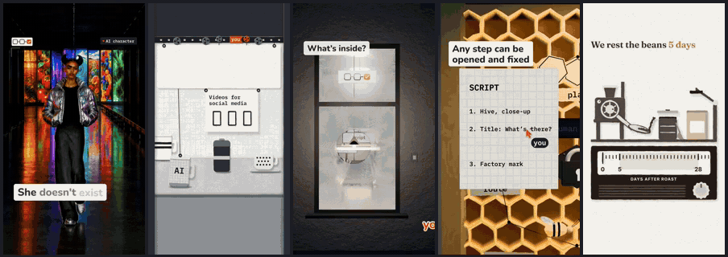
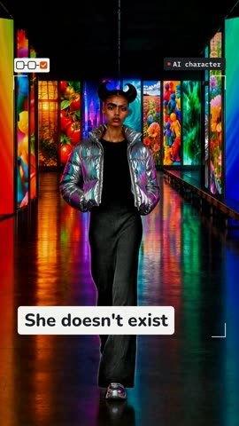
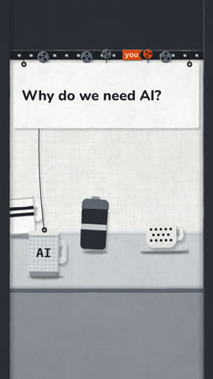
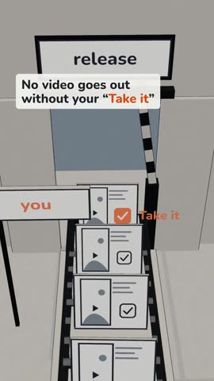
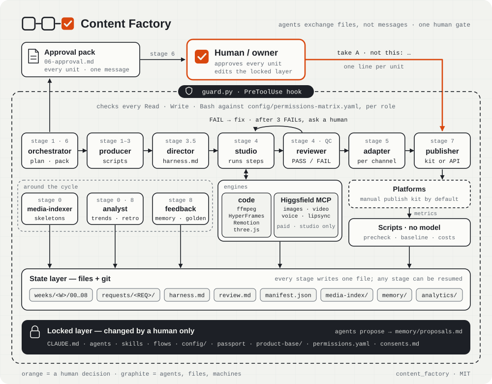
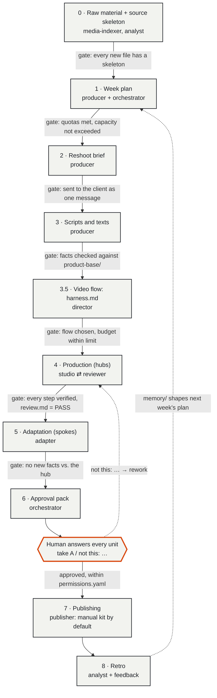
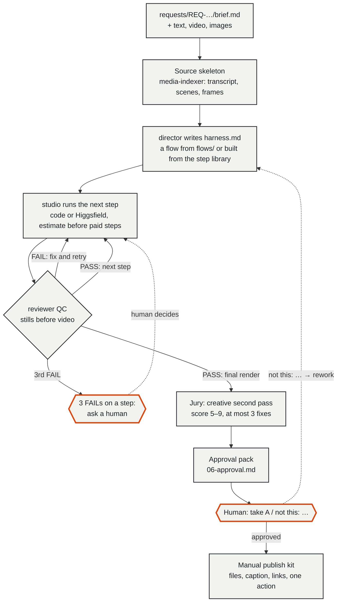
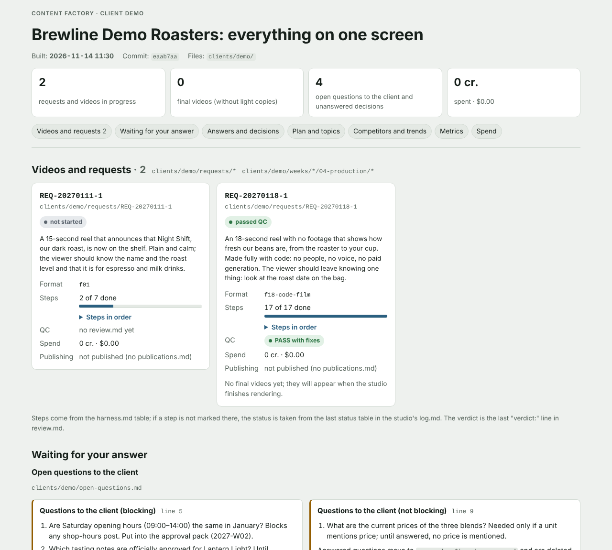

# Content Factory

[](https://github.com/neskuchny/content_factory/actions/workflows/ci.yml) [](LICENSE) [](https://www.python.org/downloads/) [](https://claude.com/claude-code)

[](#see-it-in-action)

<sub>Five videos the factory made: an AI-character clip, three code films and the demo client's example. [Details and costs below](#see-it-in-action).</sub>

A content factory for social-media video, run by [Claude Code](https://claude.com/claude-code).
Each week it turns a client's raw material and product knowledge into a plan, scripts, finished
videos and per-platform adaptations, then asks a human to approve every unit before anything is
published.

It is a harness, not an application:

- There is **no backend and no server of our own**. The roles are Claude Code subagents
  (`.claude/agents/`), the know-how is in skills (`.claude/skills/`) and flows (`flows/`), the
  "machines" are MCP generators (Higgsfield, treg) and code (ffmpeg, HyperFrames, Remotion, three.js).
- **State lives in files and git.** Agents do not talk to each other; they exchange files
  (plan, scripts, `harness.md`, review verdicts, approval pack) in `clients/<client>/`. Any stage
  can be stopped, read, corrected and resumed.
- A few small Python scripts do the deterministic parts without a model: the permissions hook,
  metric baselines, cost summaries, a dashboard, and a "is there any work to do?" gatekeeper.

It is not a hosted service, a no-code tool, or an autoposter. By default it publishes nothing
by itself.

## Start here: your own factory in one session

1. **Make your own private copy.** Client data (product facts, plans, metrics) belongs in your
   repository, not in this one, and not in a fork (a fork of a public repository is public). Either
   create an empty private repository and push a clone of this one there (keeps `git merge` updates
   easy), or press **Use this template** → Private. Locally the `setup` wizard does the git part for
   you; for a cloud session on claude.ai/code, start the session on your private copy.
2. **Open your copy in Claude Code** (desktop, terminal, or a cloud session on claude.ai/code) and say
   **"Set me up"** — in any language. Claude answers in the language you write in.
3. **Answer ten questions** in one go: your business, materials, audience, platforms, tone, who
   may appear on camera, approval, budget. Claude fills `clients/<you>/`, shows you a summary of what
   it understood with a source for every fact, and keeps the passport, product facts, consents and
   permissions as drafts until you say yes.
4. **Get the first result:** a short video made with code (0 credits) or the plan of your first week.
   Automation (scheduled runs) is optional and set up only if you ask.

In your copy you are the owner: change rules, add your own agents, skills, flows and tasks freely.
Improvements for everyone are welcome here as pull requests. Russian quick start:
[README.ru.md](README.ru.md).

## See it in action

Every video below was planned, produced and checked by the factory's agents. The first four are
from the factory's own promo series (made in Russian, re-rendered here with English titles at no
extra cost); the last one is the [demo client's end-to-end example](#a-complete-example-from-brief-to-approved-video).
Titles, numbers and logos are always drawn by code, never generated. Click a cover to play.

<table>
<tr>
<td align="center" width="20%"><a href="docs/showcase/ai-character-clip.mp4"></a></td>
<td align="center" width="20%"><a href="docs/showcase/council-at-the-table.mp4"></a></td>
<td align="center" width="20%"><a href="docs/showcase/frost.mp4"></a></td>
<td align="center" width="20%"><a href="docs/showcase/hive.mp4"></a></td>
<td align="center" width="20%"><a href="docs/showcase/freshness-dial.mp4"></a></td>
</tr>
<tr>
<td align="center"><b>AI character clip</b><br>18 s</td>
<td align="center"><b>Council at the Table</b><br>30 s</td>
<td align="center"><b>Frost</b><br>28 s</td>
<td align="center"><b>Hive</b><br>28 s</td>
<td align="center"><b>Freshness dial</b><br>18 s · demo client</td>
</tr>
</table>

| Video | How it was made | Generation cost | Checks |
|---|---|---|---|
| AI character clip | A ready-made AI character preset, 3 key frames (GPT Image), 3 × 4 s clips on Kling 4.0, music by ElevenLabs Music; titles, stamps and the end card by code. The model turned the dress into trousers in the first clip, so that clip was rescued by code (slow-motion window, push-in) instead of paying for a re-run. | 36.9 credits ≈ $1.94 | QC: PASS with fixes · jury 7/9 |
| Council at the Table | Code film, 2D paper theatre on Canvas ([`f18`](flows/f18-code-film.md)): every object arrives on a visible thread from a spool. | 0 | Stills and draft reviewed by QC |
| Frost | Code film, 3D in three.js: a lamp thaws a circle in frosted glass, behind it a shop floor of AI staff. Rendered on CPU in 11.5 min. | 0 | Stills and draft reviewed by QC |
| Hive | Code film, 3D in three.js: paper-lantern bees, a "stop / run" lever, a lock that only a human opens. Rendered on CPU in 20 min. | 0 | Stills and draft reviewed by QC |
| Freshness dial | Code film, 2D, for the fictional demo roaster. Every on-screen claim is cited from the demo product base. | 0 | QC: PASS with fixes · jury 7/9 · fixes applied |

Credits are Higgsfield credits; the dollar figure uses the fixed rate in
[`config/pricing.yaml`](config/pricing.yaml). Sound in all five is made by code. Videos are
720p copies; the factory renders 1080×1920 masters.

## The weekly cycle



A week lives in `clients/<client>/weeks/<YYYY-Www>/`. A stage does not start until the previous
one has its output. Full rules are in [`CLAUDE.md`](CLAUDE.md) section 3.

| # | Stage | Owner | Output | Gate |
|---|---|---|---|---|
| 0 | Raw material and source skeleton | media-indexer, analyst | `media-index/assets/<id>/`, `00-inputs.md` | Every new file has a skeleton |
| 1 | Week plan | producer, orchestrator | `01-plan.md` | Quotas met, capacity not exceeded |
| 2 | Reshoot brief | producer | `02-shoot-brief.md` | Sent to the client as one message |
| 3 | Scripts and texts | producer | `03-scripts/<id>.md` | Facts checked against `product-base/` |
| 3.5 | Video flow (route) | director | `04-production/<id>/harness.md`, `beats.md` | Flow chosen or assembled, budget within limit |
| 4 | Production | studio | `04-production/<id>/` | Every step verified; `review.md` = PASS |
| 5 | Adaptation | adapter | `05-adaptations/<id>/<channel>.md` | No new facts relative to the hub video |
| 6 | Approval pack | orchestrator | `06-approval.md` | A human answered for every unit |
| 7 | Publishing | publisher | `07-publications.md` | Only approved units, only within `permissions.yaml` |
| 8 | Retro | analyst, feedback | `08-retro.md`, edits to `memory/` | |

Two production rules: describe source material first (a reusable "skeleton" with transcript,
scenes and frames), and write the route first (`harness.md`, taken from or built out of
[`flows/`](flows/README.md)). Static assets are checked before any video is generated; after
three FAILs on a step the factory asks a human instead of retrying.

<details>
<summary>The weekly cycle as a diagram</summary>



</details>

One-off requests ("here is a video and some pictures, make a reel") follow the same path from a
folder `clients/<client>/requests/<REQ-id>/`.

<details>
<summary>One request, from brief to a manual publish kit</summary>



</details>

## Repository layout

```
CLAUDE.md                  rules every agent reads first: layers, stages, gates, prohibitions
.claude/agents/            11 roles: orchestrator, producer, director, studio, reviewer, adapter,
                           publisher, analyst, media-indexer, feedback, onboarding
.claude/skills/            reusable know-how (weekly-cycle, approval-pack, fact-check, source-skeleton,
                           video-code, publish-kit, perf-loop, ...); ffmpeg-skill is vendored
.claude/settings.json      wires the permissions hook
flows/                     video routes f00-f18 plus the step library (flows/README.md)
config/                    engines.yaml, permissions-matrix.yaml, pricing.yaml, locales/
scripts/                   guard/ analytics/ collect/ dashboard/ media/ qa/ ticks/
templates/                 blank client, week and request folders
clients/demo/              fictional example client (see Quick start)
docs/                      setup, how it works, methodology, formats catalogue, research notes
.github/workflows/         hourly "ticks" workflow (schedule disabled by default)
.mcp.json                  Higgsfield and treg MCP server entries for local runs
```

Everything that varies per client (passport, channels, quotas, permissions, brand, product base,
memory, weeks) lives under `clients/<client>/`. Client data is not part of the framework.

## Quick start with the demo client

`clients/demo/` is a fictional specialty-coffee roaster. All names and facts are invented. It
includes a product base, a sample week and a sample one-off request, so you can see what the
factory reads and writes before you onboard anyone real.

1. Install the prerequisites (next section) and clone this repository.
2. Look at the scripts that need no model and no account:
   ```bash
   pip install -r requirements.txt
   python3 scripts/dashboard/build.py --client demo     # writes dashboard/demo.html
   python3 scripts/analytics/costs.py --client demo     # writes clients/demo/analytics/costs.md
   ```
   Open `dashboard/demo.html` in a browser. (`Pillow` is optional; the dashboard uses it only to
   make cover thumbnails if it is installed.)
3. `config/active-client.txt` already contains `demo`. Scripts also accept `--client demo`.
4. Open the repository in Claude Code (CLI, desktop or web) and start a session:
   ```bash
   cd content-factory      # your clone
   claude
   ```
   Then say, for example: "Run the weekly cycle for the active client." Review each output file
   before moving on. The `dispatch` skill describes the manual dispatcher mode.
5. Check `clients/demo/permissions.yaml` first: it sets the weekly credit limit for paid
   generation, and publishing is `manual`.

Other run modes (scheduled cloud tasks, ticks via GitHub Actions, a server with Telegram) and
the checklist for a real client are in [`docs/04-setup.md`](docs/04-setup.md). To add your own
client, say "Set me up" (the [`setup`](.claude/skills/setup/SKILL.md) skill); to check your machine,
run `python3 scripts/setup/preflight.py`.

## A complete example: from brief to approved video

[`clients/demo/requests/REQ-20270118-1/`](clients/demo/requests/REQ-20270118-1/) is one request taken all
the way through, so you can read what each agent leaves behind:

| Step | File | Who |
|---|---|---|
| The ask | [`brief.md`](clients/demo/requests/REQ-20270118-1/brief.md) | owner |
| Concept, beats and the facts table (every on-screen claim cited from `product-base/`) | [`beats.md`](clients/demo/requests/REQ-20270118-1/beats.md) | director |
| The route: 17 steps with a status each | [`harness.md`](clients/demo/requests/REQ-20270118-1/harness.md) | director |
| Shots, camera, look and sound | [`shotlist.json`](clients/demo/requests/REQ-20270118-1/shotlist.json), [`card.md`](clients/demo/requests/REQ-20270118-1/card.md) | director |
| The film itself as code (Canvas 2D, deterministic, sound made by code) | [`production/scene/`](clients/demo/requests/REQ-20270118-1/production/scene/), [`production/project/`](clients/demo/requests/REQ-20270118-1/production/project/) | studio |
| What happened, step by step | [`production/log.md`](clients/demo/requests/REQ-20270118-1/production/log.md) | studio |
| QC verdict and the jury's score and fixes | [`production/review.md`](clients/demo/requests/REQ-20270118-1/production/review.md) | reviewer |
| Spend | [`production/costs.md`](clients/demo/requests/REQ-20270118-1/production/costs.md) | studio |
| Telegram adaptation (no new facts relative to the video) | [`adaptations/telegram_channel.md`](clients/demo/requests/REQ-20270118-1/adaptations/telegram_channel.md) | adapter |
| Owner decisions at each gate | [`decisions.md`](clients/demo/requests/REQ-20270118-1/decisions.md) | owner |

The result is [`docs/showcase/freshness-dial.mp4`](docs/showcase/freshness-dial.mp4). The owner is
fictional too: in a real run each gate waits for your answer.



## What you must bring

The repository contains no keys and no accounts.

- A **Claude Code** account (the agents run there; docs/04-setup.md assumes a Claude subscription).
- Your own **image/video generator account**. Two are wired in through MCP (`.mcp.json`):
  [Higgsfield](https://higgsfield.ai) (credits) and [treg](https://treg.to) (open source; one prepaid
  dollar balance for many video, image and voice models; skill `treg-gateway`). Use either or both;
  other generators work if you give studio access to them. Neither is needed for code-made videos.
  Generation costs money or credits on your account. The factory tracks spend in `costs.md` and
  limits it with `permissions.yaml`, but you are responsible for your account.
- Keys and tokens only as **environment secrets** or connector settings. Never commit them
  (`.env*` is git-ignored; the permissions hook also denies agent reads of secret paths).
- **ffmpeg** (6.1+ for the vendored ffmpeg-skill), **Node 22+**, **Chromium** (used for HTML/GSAP/
  HyperFrames/three.js rendering), and Python 3 with `PyYAML`.
- Optional: Linear (task board), Google Drive (approval pack), a shared drive for client sources,
  `faster-whisper` for transcripts.

## Safety model

The factory is built so that a human decides and the files show why.

- **Locked layer.** The framework (`CLAUDE.md`, agents, skills, `config/`), the client passport,
  `product-base/`, `permissions.yaml` and `brand/consents.md` can be changed only by a human. A
  `PreToolUse` hook, [`scripts/guard/guard.py`](scripts/guard/guard.py), checks every read, write
  and Bash command against [`config/permissions-matrix.yaml`](config/permissions-matrix.yaml) per
  role. An agent that wants a rule changed writes a proposal to `memory/proposals.md`.
  An interactive session with no agent role is treated as the owner; scheduled runs set
  `FACTORY_MODE=run` and act as the orchestrator.
- **Human approval per unit.** Stage 6 collects the whole week into one approval pack, and
  nothing moves to publishing without an answer for each unit.
- **Manual publishing by default.** The publisher posts only approved units and only where
  `permissions.yaml` allows automation; otherwise it prepares a manual kit (`publish-kit`).
- **Facts only from the product base.** Prices, deadlines, properties, stories and testimonials
  are never invented; a missing fact becomes a question to the client.
- **AI content is labelled** ("AI visualization" on the frame and in the caption) and is never
  passed off as a real finished object. Text, numbers and logos are applied by code, not generated.
- **Real people** appear only with consent recorded in `brand/consents.md`.
- **Untrusted web content is data.** Agents that read the web do not publish or spend.
- **Spending is bounded.** Only studio generates, with an estimate before each paid step and a
  limit from `permissions.yaml`.

The hook is a guardrail, not a sandbox. Read [`SECURITY.md`](SECURITY.md) for what is in scope
and how to report a problem.

## Languages

Language is a per-client setting: `passport.yaml: language` (a BCP-47 code, default `en`). The
plan, approval pack, scripts and captions use it. The framework files are in English. Locale
data, such as the anti-jargon stoplists used by `scripts/qa/words_check.py --lang <code>`, lives
in `config/locales/` (`en.yaml`, `ru.yaml`). To add a language, copy one of them.

## Status and limitations

This is an opinionated working harness extracted from real use, not a polished product.

- The framework, flows, permissions hook, metric scripts and gatekeeper exist and have been
  exercised with scripts. At the time `docs/07-how-it-works.md` was written, no agent had yet
  passed a full weekly cycle end to end; expect to tune prompts and flows.
- Higgsfield, treg and the models behind it, ElevenLabs (through Higgsfield), Linear, Google Drive, Telegram and any other
  service are third-party. They have their own terms, pricing and availability, and your own
  accounts are required. Model names in the flows reflect what was available when written and
  will drift.
- Several flows assume paid generation; each flow file has a `cost:` line. Some need little or
  none (`f07` long-to-short: no generations, `f18` code film: 0 credits, `f10` infographic: 0-3
  images).
- Remotion has its own license terms (paid for companies above a size threshold); it is only
  referenced as an optional install. HyperFrames, fonts, three.js and Playwright are not bundled.
- The scripts are small and lightly tested. Platform metric collectors are limited
  (`scripts/collect/telegram_public.py` reads public channels); other platforms need your own access.
- `config/pricing.yaml` holds a fixed credit-to-dollar rate taken from one Higgsfield plan, not a live price. Set your own.

## Documentation

- [`docs/04-setup.md`](docs/04-setup.md): running the factory (scheduled tasks, ticks, server, manual)
- [`docs/07-how-it-works.md`](docs/07-how-it-works.md): components, who exchanges what, a week step by step
- [`docs/08-harness-methodology.md`](docs/08-harness-methodology.md): the methodology in general terms
- [`docs/06-memory-analytics-ticks-permissions.md`](docs/06-memory-analytics-ticks-permissions.md): memory, metrics, ticks, permissions
- [`docs/05-video-formats-catalog.md`](docs/05-video-formats-catalog.md): video formats, techniques, models, tools
- [`docs/01-research-content-factory.md`](docs/01-research-content-factory.md), [`docs/02-research-formats-and-tools.md`](docs/02-research-formats-and-tools.md), [`docs/10-external-tools-review.md`](docs/10-external-tools-review.md): research notes
- [`flows/README.md`](flows/README.md): flow format, step library, catalogue
- [`CHANGELOG.md`](CHANGELOG.md); for maintainers: [`docs/maintainers/repo-settings.md`](docs/maintainers/repo-settings.md) (GitHub settings, first release)
- [`CONTRIBUTING.md`](CONTRIBUTING.md), [`CODE_OF_CONDUCT.md`](CODE_OF_CONDUCT.md), [`SECURITY.md`](SECURITY.md), [`THIRD_PARTY_NOTICES.md`](THIRD_PARTY_NOTICES.md)

## License

[MIT](LICENSE). Third-party material is listed in [`THIRD_PARTY_NOTICES.md`](THIRD_PARTY_NOTICES.md).

## Disclaimer

This project is not affiliated with, endorsed by or sponsored by Anthropic, Higgsfield, treg,
ElevenLabs, Remotion, Linear, Google, or the authors of any other product or project mentioned
here. Product and company names are used only to describe compatibility and belong to their
respective owners.
