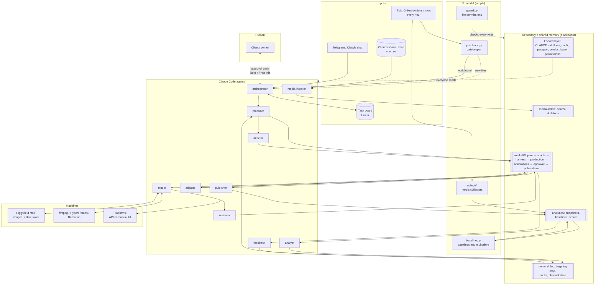
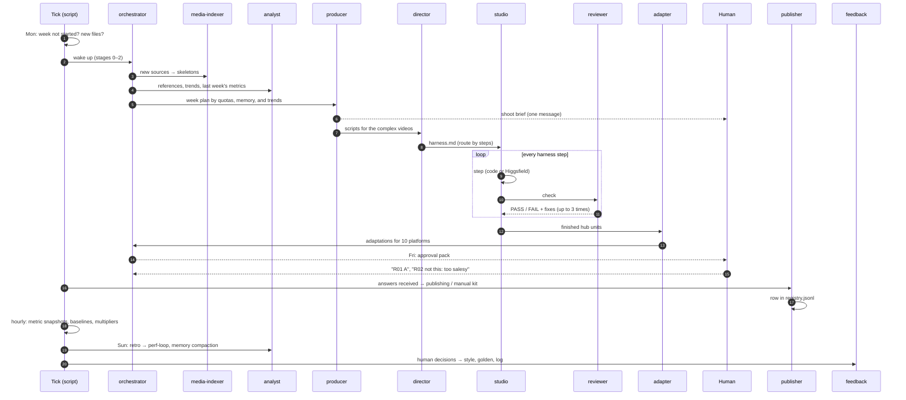

# How the content factory works: the harness internals

> A description of the system's current state (2026-10-26): what it consists of, who exchanges
> information with whom and through what, which services are connected, how a week and a one-off
> request run. The generalized methodology is in `08-harness-methodology.md`.

---

## 1. One picture

**The main idea:** agents do not talk to each other directly. They exchange **files** in the
repository (a shared board, a blackboard) and **tasks** on the Linear board. Who writes and reads
what is defined in advance, and the permissions hook enforces it. So any stage can be stopped,
inspected by eye, corrected, and resumed from the same place.

---

## 2. What the harness consists of

| Layer | What it is | Where it lives | Factory analogy |
|---|---|---|---|
| **Constitution** | Stages, gates, prohibitions, planning rules | `CLAUDE.md` | Charter and safety rules |
| **Roles** | 11 agents: model, thinking depth, tools, allowed MCPs, prompt | `.claude/agents/*.md` | Job descriptions |
| **Skills** | 23 skills (incl. the vendored ffmpeg-skill, the `setup` first-run wizard and `treg-gateway`): how to do a specific job (skeleton, hooks, seams, approval, memory compaction…) | `.claude/skills/*/SKILL.md` | Process cards |
| **Flows** | 19 flows (f00–f18) + a library of atomic steps | `flows/` | Routing cards for products |
| **Configs** | Format → engine, permissions matrix | `config/` | Workshop regulations |
| **Client data** | Passport, platforms, quotas, permissions, brand, product, sources, memory, weeks | `clients/<c>/` | The customer and their warehouse |
| **Scripts** | Permissions (guard), metrics (collect, baseline), ticks (precheck, run.sh) | `scripts/` | Automation with no people |
| **Templates** | New client, week, request | `templates/` | Blank forms |

There is no application code. Everything that can be described in words is described in words.
The deterministic parts (permissions, metrics, "is there work") are small scripts with no model.

---

## 3. Who exchanges information with whom

### 3.1 Exchange channels
| Channel | What is passed | Who writes → who reads |
|---|---|---|
| **Week files** `weeks/<W>/` | Stage artifacts: plan, shoot brief, scripts, harness, video files, review, adaptations, approval, publishing log, retro | Each agent writes its own stage, the next one reads |
| **Linear board** | Tasks `[W44-R03] what to do`, assignee `agent:<name>`, a report comment (what was done, where, what it cost) | Only orchestrator creates tasks; assignees report |
| **A video's harness.md** | A step-by-step route with input/output/check/status for each step | director writes → studio executes and marks statuses → reviewer gives verdicts |
| **memory/** | What was published, what works, where we are now | analyst and feedback write → producer, director, orchestrator read when planning |
| **analytics/** | Numbers | Scripts write → analyst reads |
| **media-index/** | Source skeletons | media-indexer writes → producer, director, studio read |
| **Approval pack** | All of the week's units in one message, answers "Take A / Not this: …" | orchestrator → human → feedback, publisher |
| **proposals.md** | Proposals to change the rules | Any agent → owner |

### 3.2 "Reads / writes" matrix (abridged)
| Agent | Reads | Writes | External services |
|---|---|---|---|
| orchestrator | everything of the client | weeks, one-off requests, quotas and platforms (after a "yes"), changelog | Linear, Telegram |
| producer | passport, product, memory, skeletons, trends | plan, shoot brief, scripts | — |
| director | script, skeletons, flows, brand, golden | harness, beats, shotlist | Higgsfield: model catalog only |
| media-indexer | the client's drive | media-index | Shared drive, e.g. Yandex Disk (read) |
| studio | harness, script, skeletons, brand | production files, manifest, costs, templates | **Higgsfield (generation)**, ffmpeg, HyperFrames / Remotion |
| reviewer | production files, product | only `review.md` | Higgsfield: read only |
| adapter | the finished unit, platforms | adaptations | — |
| publisher | approved items | publishing log, kits, registry | Platform APIs (when allowed) |
| analyst | analytics, references | references, trends, retro, conclusions into memory | web (read only) |
| feedback | human decisions, retro | memory, brand voice and style, golden | — |
| onboarding | the client questionnaire | `clients/<new>/` | — |

The full matrix is `config/permissions-matrix.yaml`, enforced by `scripts/guard/guard.py`.

---

## 4. How a week runs

**A one-off request** (text / video / video + images) follows the same chain, but shorter:
`requests/<REQ>/brief.md` → media-indexer (skeleton) → director (harness) → studio ⇄ reviewer →
approval pack (or straight to the human, if urgent).

---

## 5. How one video works inside (an example pilot: a product placed on an empty plot)

1. **Skeleton.** media-indexer downloads the client's video from the drive into a temp folder, makes
   a transcript, scenes, frames, and captions → `media-index/assets/<id>/packed.md`. It finds a
   static shot of the empty plot.
2. **Route.** director reads the skeleton and the brief, picks `flows/f04-object-insert-broll.md`
   (insert) or `f05` (directly in frame), and writes `harness.md` with steps, checks, and a credit budget.
3. **Step by step** (studio; after every generative step, reviewer):
   `extract_frame` (ffmpeg, exact frame A) → `image_edit` (Higgsfield: Nano Banana Pro, frame B with
   the product placed from the product photo) → `review_still` → `flf_video` (Kling 3.0 Omni Frames: A→B) →
   `review_video` → `seam` (matching fps, color, grain) → `overlay` (the "AI visualization" badge, in code) → `render`.
4. **Traces.** Every step leaves a file and a status. `manifest.json` stores prompts, models, seeds,
   and credits, so a video can be repeated or rebuilt "from the cast".
5. **Stops.** Budget exhausted, 3 FAILs in a row, or no product photo → a question to a human, not
   "finish it somehow".

---

## 6. Which services the factory can use

The factory is built to work with the services below. Status shows what was verified when this
document was written (2026-10-26) in the reference setup; in your own copy each service needs your
own account or access.

| Service | What for | Status |
|---|---|---|
| **Claude Code** (cloud session, v2.1.310) | Agent runtime | ✅ works |
| **GitHub** (your private repository) | Storage for the harness and memory, branches, Actions | ✅ push works; the Actions file is in the repository, secrets are not set until you add them |
| **Higgsfield MCP** | Image and video generation, video editing, lipsync, voice, cloud editing | ✅ connected, model catalog and workflows read; no generations yet |
| **Linear** | Task board (a team of your choice) | ✅ connected; the factory project is created by you |
| **Google Drive** | Approval pack, finished files for the client | ✅ connector available; folders are set up by you |
| **Client's shared drive** (e.g. Yandex Disk) | Sources | ✅ public API without a key, listing works (an archive of thousands of files was indexed in batches) |
| **Telegram (public channels)** | Metrics and trends | ✅ collector via `t.me/s/`, verified on a public channel |
| ffmpeg 6.1, Node 22, Python 3.13, Bun, PyYAML | Editing and scripts | ✅ installed in the container |
| **HyperFrames / Remotion** | Motion graphics in code | ⏳ not installed (one command each) |
| **faster-whisper** | Transcript for the skeleton | ⏳ not installed |
| Telegram bot (Channels) | Chat with the factory | ⏳ needs a server with a persistent session |
| Platform statistics APIs (YouTube, VK, MTProto, LiveDune…) | Metrics of your own posts | ⏳ need the client's access |
| DaVinci Resolve Studio MCP | Heavy editing and color | ⏳ optional, local only and with a Studio license |
| "Dispatcher" cloud task + `FACTORY_MODE=run` environment | Autonomous runs | ⏳ created manually per `docs/04-setup.md` |

**Honest status:** the framework, flows, permissions, metrics, and gatekeeper exist and were checked
with scripts. No agent had yet passed a full cycle at the time of writing. The first such run is
the pilot (see `clients/demo/` for an example client you can run it on).

---

## 7. Safeguards built into the harness

| Risk | Safeguard |
|---|---|
| An agent rewrote the rules or the client passport | Permissions hook: the locked layer is closed to all agents |
| An agent went into someone else's folder | Permissions matrix by role (`config/permissions-matrix.yaml`) |
| Generation credits burned | Only studio generates; an estimate before each step; the limit in `permissions.yaml`; static before video |
| The model spins idle | Gatekeeper with no model; `--max-turns`, `--max-budget-usd` |
| Invented facts | The `fact-check` skill: only the product base; otherwise a question |
| Generation defects reached the client | Executor ≠ controller: only reviewer writes the verdict |
| Published without asking | Only publisher publishes, and only approved items; by default a manual kit |
| Failure in the middle of work | State is in files: resume from the open step (the `weekly-cycle` skill) |
| Injection from the web or others' posts | Agents that read the web do not publish or spend; tick payloads are data only |
| Memory bloat | Index ≤ 200 lines, weekly and monthly compaction |
