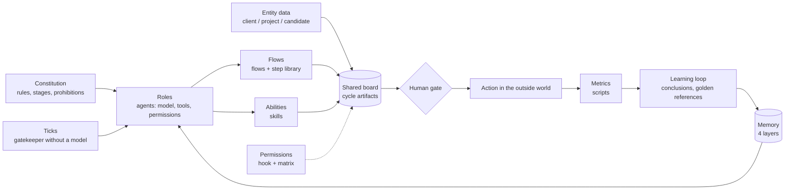

# Harness methodology: how to make a swarm of agents work reliably without building your own app

> A generalization of how the content factory is built, so the same approach can be applied to other tasks
> (sales, research, support, hiring, development, e-commerce, training…).
> The concrete design of the factory is in `07-how-it-works.md`.

---

## 1. What a harness is

A **harness** is the scaffolding around AI agents that turns a "smart but unpredictable model"
into a **repeatable process**. It answers six questions:

1. **What is allowed and what is not**: the constitution and permissions.
2. **Who does what**: roles.
3. **In what order, and when the work is done**: stages with gates, and flows.
4. **Where state lives**: shared files (a blackboard), not session memory.
5. **How the system learns**: metrics → conclusions → targeted edits → golden references.
6. **When to wake up and when to call a human**: ticks and escalations.

A harness is **not an application**. The model can already do almost everything; the harness sets the boundaries, the order and the memory.
Code is written only where determinism is needed: permissions, metrics, "is there any work".

---

## 2. Twelve principles

| # | Principle | Why | In the content factory |
|---|---|---|---|
| 1 | **State in files, not in heads** | Sessions break, context is forgotten, there are many agents. A file is visible, can be fixed, and work can continue from it | `weeks/<W>/`: one file per stage; recovery by which files exist |
| 2 | **Agents communicate through the board, not with each other** | Direct agent-to-agent conversations are invisible and not reproducible | Files + tasks in Linear; each file has one author |
| 3 | **Three layers of mutability** | If everything can be changed, the system "drifts" within a couple of weeks | Locked layer (human only) / variables (by procedure) / artifacts (agents) |
| 4 | **Prohibitions by code, not by request** | A model can violate a request; a hook cannot be violated | `guard.py` + a role permission matrix |
| 5 | **Stages with an output and a gate** | "Do everything" does not work; "do a step, show the result, check it" does | 9 stages, each with an output file and a transition condition |
| 6 | **Understand the input first, then the task** | A description of the source is reusable; a task applied directly is not | Source skeleton before any video |
| 7 | **Flow before work; cheap before expensive** | Complex work without a plan falls apart; expensive steps must not be spent on defects | The video's `harness.md`; stills before video |
| 8 | **Executor ≠ controller; an iteration limit** | Self-checking misses its own errors; endless revisions burn the budget | reviewer issues the verdict; 3 FAIL → human |
| 9 | **A human at one point, in one pack** | If every little thing needs approval, the human becomes the bottleneck | One approval pack per week, answered in one line |
| 10 | **Deterministic work goes to scripts** | A model is expensive and non-deterministic where the answer is unambiguous | Tick gatekeeper, collectors, baseline calculation, permissions |
| 11 | **Learn from relative metrics and evidence** | Absolute numbers mislead; a rule drawn from one case breaks the system | Channel baseline, post multiplier; a rule only after repeats; golden references with a reason |
| 12 | **Least privilege; whoever reads untrusted content does not act** | Injections from the web; an agent with full access "just in case" | The scout reads the web but does not publish or spend; only studio generates |

Plus two practical heuristics:
- **Model by task:** an expensive one where data is scarce and accuracy matters (meaning, plan, analysis of
  feedback); a cheap one for the stream (search, adaptation, publishing).
- **Progressive context loading:** the constitution is short (everyone reads it), details live in skills and
  flows (read as needed), history is compressed into an index.

---

## 3. Anatomy: universal components



| Component | What is inside | File in this repository (can be copied) |
|---|---|---|
| **Constitution** | Mutability layers, stages and gates, prohibitions, planning rules, board protocol | `CLAUDE.md` |
| **Roles** | One agent per function: model, effort, tools / disallowedTools, MCP, skills, memory | `.claude/agents/*.md` |
| **Abilities** | Playbooks for repeated work | `.claude/skills/*/SKILL.md` |
| **Flows** | Standard paths for types of work + a library of atomic steps from which a new path is built | `flows/README.md`, `flows/f*.md` |
| **Configs** | Type of work → tool; permission matrix | `config/engines.yaml`, `config/permissions-matrix.yaml` |
| **Entity data** | Everything that distinguishes one client / project from another | `clients/<c>/`, template `templates/client/` |
| **Shared cycle board** | A cycle folder with stage files | `clients/<c>/weeks/<W>/`, template `templates/week/` |
| **Memory** | Locked layer / compressed experience / numbers cells / assets | `memory/`, `analytics/`, `brand/` |
| **Scripts** | Permissions, metric collection, scoring, gatekeeper | `scripts/guard`, `scripts/collect`, `scripts/analytics`, `scripts/ticks` |
| **Ticks** | An hourly check without a model → wakes the right agent | `.github/workflows/factory-ticks.yml`, `scripts/ticks/run.sh` |
| **Human gate** | One pack of decisions per cycle | skill `approval-pack` |

### Life cycle of a unit of work (common to any task)
```
input → input skeleton → plan → flow (harness) → steps: do → check (≤3) →
→ pack to the human → action in the outside world → log + metrics → conclusions → memory
```
Statuses: `planned → in_progress → produced → reviewed → in_approval → approved | rejected | rework → done`.

---

## 4. How to build a harness for a new task: 12 steps

1. **Unit of work.** What comes out at the end? (a video, a letter, a report, a client reply, a product card, a PR).
2. **Entity.** Who or what is the work for? (a client, project, candidate, product). This becomes `entities/<id>/`.
3. **Cycle.** What rhythm? (week, sprint, request, day). This is the cycle folder with stage files.
4. **Stages and gates.** 5–9 stages; for each, an output (a file) and a "done" condition.
5. **Locked layer.** What must not change without a human? (product facts, legal
   constraints, budgets, permissions). Put it into the matrix's `protected` list right away.
6. **Roles.** One role per function where a different view or different permissions are needed. Required:
   a coordinator, an executor, a **separate** controller, a feedback agent.
   Do not multiply: two roles with the same permissions and inputs are one role.
7. **Flows.** Typical kinds of work → a standard flow; plus a step library for building
   non-standard ones. Each step has: input, output, check, price.
8. **Tools.** Which MCPs and scripts are needed; who may use which (paid and external ones for the fewest roles).
9. **Human.** Exactly one approval point and the answer format (one line).
10. **Result metric.** How to tell it worked, **relative to a baseline**. Who collects it (a script).
11. **Memory.** What to compress into the log, where conclusions with evidence go, where golden references go.
12. **Ticks.** Which "there is work" conditions are checked without a model; what wakes which agent; step and budget ceilings.

Readiness check: can you stop the process at any stage, open the files, understand what is
going on, and continue? If yes, the harness is built.

---

## 5. Examples of transfer to other tasks

| Task | Unit | Input skeleton | Stages (condensed) | Roles beyond the basic ones | Human gate | Metric (relative to baseline) | Tools |
|---|---|---|---|---|---|---|---|
| **Cold sales** | A letter / sequence | Company and decision-maker profile from CRM and website | segment → research → drafts (3 variants) → fact and tone check → approval → sending → replies | researcher, copywriter, checker, sender | A pack of letters per day | Reply rate vs. the segment baseline | CRM MCP, mail, web |
| **Analytical reports / research** | A report | Sources → fact cards with citations | question → plan → collection → cards → draft → fact check → editing → release | collector, fact-checker, editor | Approval of the plan and the final | Repeat requests / customer rating | Web, article databases, documents |
| **Customer support** | A reply to a request | Request + customer history + knowledge base | classification → draft → policy check → send / escalate → weekly review | triage, responder, policy-checker | Non-standard cases only | Resolution time, repeat requests | Helpdesk MCP, knowledge base |
| **Hiring** | A candidate shortlist | Resume → skills card | vacancy → sources → screening → cards → bias check → shortlist → feedback | sourcer, screener, bias-checker | A shortlist once a week | Share of candidates reaching an offer | ATS MCP, mail |
| **Development** | A PR | Task + code map | task → plan → code → tests → review → PR → CI → merge | planner, coder, reviewer, tester | PR review | Rework returns, time to merge | GitHub, CI |
| **E-commerce product cards** | A product card | Photos + specifications → product skeleton | product → photos (background, angles) → texts → SEO → fact check → export → sales | photographer (AI), copywriter, seo | A pack of cards | Card conversion vs. the category baseline | Higgsfield, marketplace API |
| **Training / courses** | A lesson | Expert materials → topic skeleton | program → script → slides and video → check → publishing → student progress | methodologist, producer, reviewer | The program and the final lessons | Watch-through and completion vs. the course baseline | HyperFrames, avatar, LMS |

**What carries over unchanged:** the constitution template, the permissions script, the tick gatekeeper,
the approval pack, memory compaction, the "baseline → multiplier → conclusion" metrics loop, the board protocol.
**What is written anew:** roles, flows, the input skeleton, the metric, the entity's locked layer.

---

## 6. Minimal skeleton of a new harness

```
<harness>/
├── CLAUDE.md                     # layers, stages and gates, prohibitions, board protocol (≤ 200 lines)
├── .claude/
│   ├── settings.json             # permissions hook (copy)
│   ├── agents/                   # coordinator, worker(s), checker, feedback, (scout), (publisher)
│   └── skills/                   # cycle, approval-pack, memory-compaction, perf-loop + domain skills
├── flows/                        # README (step library) + flows for typical work
├── config/
│   ├── permissions-matrix.yaml   # protected + role permissions
│   └── engines.yaml              # type of work → tool
├── scripts/
│   ├── guard/guard.py            # copy as is
│   ├── ticks/precheck.py         # rewrite the "there is work" conditions
│   ├── collect/                  # metric collectors for your domain
│   └── analytics/baseline.py     # copy (baseline → multiplier)
├── entities/<id>/                # passport, permissions, fact base, memory, cycles
└── templates/                    # entity, cycle, request
```

---

## 7. Anti-patterns (what breaks harnesses)

| Anti-pattern | What happens | Cure |
|---|---|---|
| One "smart agent" for everything | Loses context, checks itself, spends the expensive model on routine | Roles + a controller + model by task |
| State in the chat | A failure = start over; it is not visible what has been done | Stage files |
| A long constitution | The model ignores the middle; rules contradict each other | ≤ 200 lines; details go into skills and flows |
| An agent edits its own rules | Drift: a month later the system does the wrong thing | Locked layer + hook; suggestions via proposals |
| A rule from one case | A coincidence becomes law | Repeats and evidence; feedback only for targeted changes |
| Absolute metrics | False wins and losses | The entity's own baseline and format, the same age |
| Waking the model to "check whether there is work" | Limits burn, the agent invents work | A gatekeeper script |
| Approving every step | The human is a bottleneck, automation loses its point | One pack per cycle |
| An expensive step right away | Defects at the most expensive stage | A cheap check before the expensive one (stills before video, plan before code) |
| Full access "so it doesn't get in the way" | An injection or a mistake with consequences | Least privilege; whoever reads untrusted content does not act |

---

## 8. When a harness is not enough and code is needed
- An interface for many people is needed (a client portal, a dashboard) → a small web app or an artifact on top of the same files / DB.
- Strict transactions and parallel writes by many agents to one place → a DB instead of files.
- Real time (a reply within seconds) → a service, not ticks.
- A regulated domain (finance, medicine) → formal checks and an audit in code.

In all other cases a harness of files, roles, flows and a few scripts is cheaper,
more transparent and faster to change.
